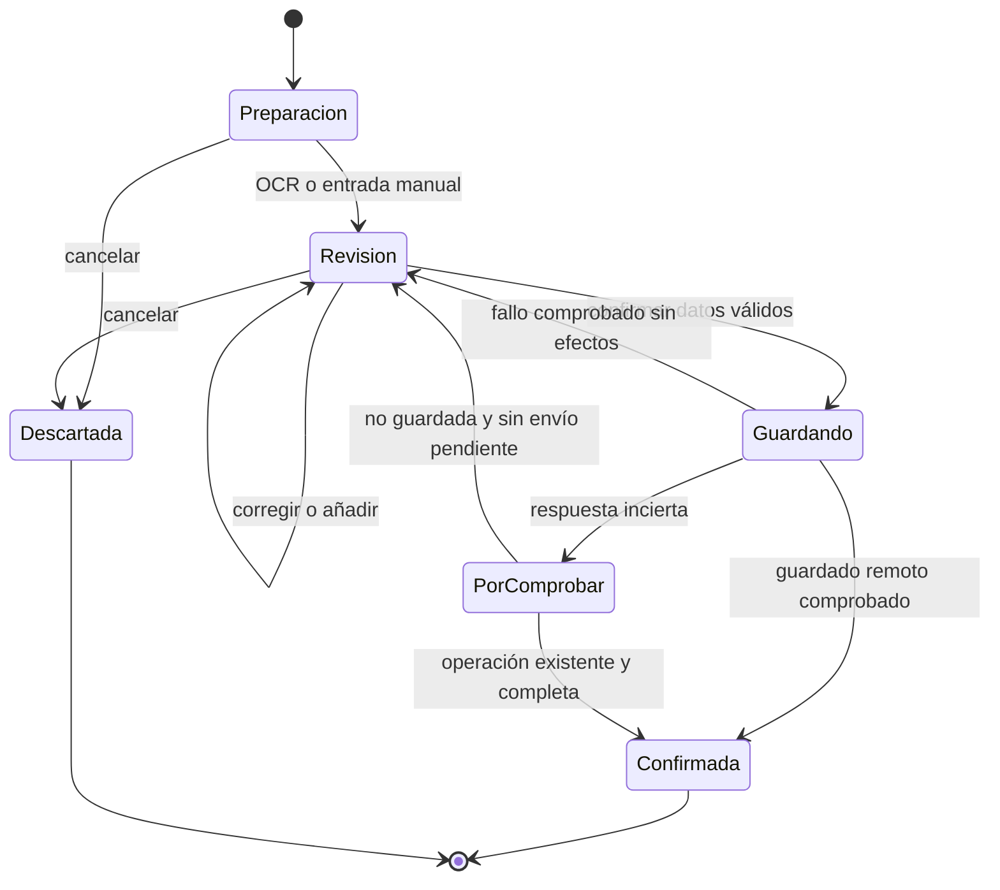

# Mi Casa — Reglas de negocio

Estado: fase 1. Reglas para revisión funcional, sin implementación ni esquema definitivo de Firestore.

## 1. Convenciones y conceptos

**O** identifica una regla expresamente solicitada; **D**, una regla derivada necesaria para cumplir el encargo con coherencia; **P**, una política propuesta pendiente de aprobación. Las decisiones DP se mantienen en [VISION.md](VISION.md#8-decisiones-pendientes-de-aprobación). Describir una propuesta no la convierte en alcance aprobado.

| Concepto | Significado |
| --- | --- |
| Producto | Identidad de un artículo físico del hogar, con nombre, categoría y modo de control. No es una línea de recibo. |
| Línea de compra | Adquisición concreta: producto o concepto, cantidad aplicable, presentación, importes y categoría histórica. Varias líneas pueden referirse al mismo producto. |
| Borrador | Información en preparación, obtenida por OCR o a mano. No representa gasto ni reposición. |
| Compra confirmada | Registro estructurado revisado y guardado correctamente, junto con sus efectos. |
| Gasto sin inventario | Desembolso por un concepto que no es un producto físico incorporable al hogar, por ejemplo un servicio. |
| Existencia | Saldo en una unidad definida, en modo exacto, o estado cualitativo en modo sencillo. |
| Movimiento de inventario | Efecto sobre existencias. No es por sí mismo un gasto adicional. Su persistencia separada es una decisión técnica futura. |
| Precio histórico | Información de una adquisición pasada; no se sustituye por el precio actual del producto. |
| Identidad de operación | Identificador estable del mismo intento de guardado, reutilizado en reintentos y conciliación. No es un número de recibo obligatorio. |

La representación conjunta de compras y gastos sin inventario descrita abajo es una propuesta conceptual de DP-13. No define colecciones, documentos, índices ni interfaces técnicas.

## 2. Compras, revisión y guardado

### RB-CO-01 — Separar preparación y confirmación (O/D)

Capturar fotos, ejecutar OCR, añadir líneas, corregirlas y revisar el total no modifica existencias ni registra gasto. Los productos nuevos preparados dentro de ese borrador no se incorporan definitivamente por el mero reconocimiento.

El alta independiente y explícita de un producto en inventario es una operación diferente. El momento de persistir productos nuevos junto con la compra deberá respetar la coherencia de RB-CO-06.

Estados funcionales necesarios: **en preparación**, **en revisión**, **guardando**, **confirmada**, **descartada** y **resultado por comprobar**. No implican que todos deban almacenarse remotamente.

«Resultado por comprobar» no equivale a «falló». No se permite tratar una compra en envío como un borrador cancelado sin comprobar qué ocurrió.

### RB-CO-02 — Reconocimiento como propuesta (O/D)

Tesseract.js reconoce texto; interpretar ese texto como fecha, establecimiento, cantidad o precio es otra etapa. El contenido detectado nunca confirma una compra por sí mismo.

Un valor dudoso queda por revisar o sin resolver. No se inventan artículos ni precios ni se transforma un dato desconocido en cero. Un cero expresamente verificado, por ejemplo un artículo gratuito, es distinto de un campo vacío. La confianza de lectura no garantiza que un importe sea precio unitario en vez de total de línea.

Si el OCR falla parcial o completamente, la entrada manual sigue disponible. Repetir el reconocimiento no puede sobrescribir en silencio las correcciones humanas.

### RB-CO-03 — Revisión y corrección previas (O/D)

Antes de confirmar siempre se puede editar artículos, cantidades y precios; retirar líneas incorrectas; añadir productos y seleccionar existentes. El resumen se recalcula después de cada cambio válido.

Eliminar una línea del borrador solo la excluye de esa compra. No elimina el producto del catálogo ni modifica compras anteriores. La revisión debe distinguir precio unitario, importe de línea y total de compra para evitar multiplicaciones duplicadas.

No se confirma un importe sin resolver ni una línea física sin producto y efecto de inventario definido. La política de fecha y establecimiento faltantes sigue pendiente en DP-09; no se sustituye una fecha ambigua por la actual de manera silenciosa.

### RB-CO-04 — Varias fotos, una compra (O/D)

Las fotos de un mismo recibo forman un solo borrador. Encabezados, subtotales y totales repetidos no se suman entre imágenes. Las zonas superpuestas pueden producir candidatos duplicados que la usuaria debe poder revisar.

No se borran automáticamente dos líneas solo porque comparten nombre, cantidad y precio: el comercio pudo imprimir dos adquisiciones legítimas. No se mezclan fotos de compras distintas sin advertir que deben registrarse por separado.

### RB-CO-05 — Vinculación de productos (O/D)

Cada línea física confirmada se vincula a un producto existente o a un producto nuevo revisado. Las coincidencias consideran nombre y presentación; el OCR abreviado por sí solo no demuestra identidad. El aprendizaje de alias y la fusión de productos no son obligatorios, DP-10.

Varias líneas del mismo producto conservan sus importes y cantidades de adquisición. Para actualizar existencias se reúnen sus efectos compatibles una sola vez. Seleccionar un producto no modifica su saldo hasta confirmar.

### RB-CO-06 — Coherencia, identidad y reintentos (D)

El guardado de una compra debe producir todos sus efectos o ninguno: registro estructurado, importe final canónico, incorporación de productos nuevos y actualización de existencias asociadas. El gasto puede derivarse de la compra; no exige escribir una segunda entidad financiera.

Cada intento conserva una identidad estable. Doble toque, reintento automático o nueva petición por falta de respuesta reutilizan esa identidad y el contenido acordado; nunca generan automáticamente otra compra. Una operación ya completada no vuelve a sumar stock ni dinero.

Cuando el resultado es incierto, primero se consulta y concilia el mismo identificador. Una lectura de caché o una escritura local pendiente no demuestran confirmación remota. Tampoco una consulta puntual sin resultado demuestra que un envío todavía en curso no vaya a completarse.

La futura solución debe demostrar atomicidad y reglas remotas con el tamaño de compra admitido. Si excede límites, se debe explicar el impedimento antes de guardar; no dividir silenciosamente la compra en pasos que dejen una mitad confirmada. El límite y la solución técnica requieren DP-07.

La detección de un mismo recibo registrado de nuevo como una operación distinta no queda resuelta solo con idempotencia. Un aviso por similitud es una mejora opcional, DP-10; no se rechazan compras legítimas solo por compartir fecha, comercio e importe.

### RB-CO-07 — Concurrencia y resultado visible (D)

Aunque haya una sola usuaria, dos pestañas o dispositivos pueden modificar existencias. Una reposición no debe sobrescribir un saldo más reciente con una lectura antigua. Si cambia una unidad, un modo de control o un dato que afecta el cálculo, se revalida o se pide revisión antes de confirmar.

El mensaje de éxito aparece después de comprobar el guardado remoto de todos los efectos. Durante el envío no se ofrecen acciones que aparenten deshacer una compra ya comprometida. Si se pierde la sesión, se recupera el acceso y se verifica el resultado antes de reenviar.

## 3. Productos e historial

### RB-PR-01 — Productos físicos y conceptos sin stock (O/D)

Todo artículo físico comprado se incorpora al inventario, independientemente de su categoría o de que sea consumible o duradero. Una etiqueta «sin inventario» no se usa para saltarse la creación de un producto físico.

Los gastos por servicios u otros conceptos sin producto físico no crean existencias. Una compra puede contener ambos tipos de línea. La propuesta DP-13 permite registrar también un desembolso independiente con el mismo principio financiero, sin exigir cantidad o unidad ficticia a un servicio.

### RB-PR-02 — Identidad y duplicados (O/D)

El nombre visible no es un identificador único. Nombres parecidos pueden describir presentaciones diferentes; el mismo producto puede aparecer abreviado en distintos recibos. La usuaria puede elegir una coincidencia o confirmar que se trata de otro artículo.

No se fusionan productos ni se cambia su presentación basándose únicamente en una similitud de texto. La forma de agrupar distintas presentaciones bajo una identidad común debe acordarse en DP-03/DP-10.

### RB-PR-03 — Categorías (O/P)

Los productos tienen categoría y los gastos se pueden consultar por ella. El catálogo inicial, su edición y la opción «Sin clasificar» quedan propuestos en DP-08. No se inventa una clasificación segura donde el dato es desconocido.

Para que el informe por categorías sea conciliable, cada importe se asigna una sola vez; la política de descuentos y cargos se explica en RB-IM-03 y RB-GA-02.

### RB-PR-04 — Historia estable (D/P)

Una compra guarda una descripción estructurada suficiente para entender qué se adquirió, cantidad, presentación e importes. Renombrar o reclasificar el producto actual no debe destruir ese contexto.

Se propone conservar la categoría de cada línea en el momento de la compra y usarla en informes históricos, DP-08/DP-12. Esto evita que editar el catálogo cambie informes pasados sin una acción explícita. La política alternativa de reclasificación histórica requeriría aprobación.

## 4. Cantidades, unidades y presentaciones

### RB-CA-01 — Magnitud y cantidad conocidas (O/D)

El inventario exacto identifica magnitud y unidad: por ejemplo unidades, gramos o mililitros. No se suman una botella, un litro y un kilogramo sin una relación válida. La cantidad de una línea física de adquisición ordinaria debe ser positiva y conocida antes de aplicar su efecto exacto.

La cantidad comercial del recibo y el contenido de un empaque son datos distintos. Que el nombre diga «leche» no permite deducir litros ni cantidad de envases.

### RB-CA-02 — Conversiones explícitas (D/P)

Solo se convierte entre unidades compatibles y con factor conocido. Propuesta DP-03: una unidad base por producto y conversiones normalizadas, como 1 kg = 1.000 g o 1 L = 1.000 ml. No se convierten peso y volumen sin información adicional ni se infiere densidad.

Ejemplo condicionado a esa política: saldo de 500 ml más 2 botellas confirmadas de 1 L produce 2.500 ml. Si el contenido de la botella es desconocido, hay que resolverlo, elegir una unidad de conteo compatible o revisar el producto; no asignar 1 L por defecto.

### RB-CA-03 — Precisión y representación (D/P)

Las cantidades fraccionarias se conservan de forma reproducible; no se redondea un peso a unidades enteras por comodidad. Escalas, límites de decimales, conversiones admitidas y visualización requieren DP-02/DP-03.

Las cantidades comerciales verificadas también pueden conservarse en compras de productos sencillos, sin convertirlas en un supuesto saldo exacto del hogar.

### RB-CA-04 — Saldo inicial y cambios de modo (P)

Propuesta DP-03: pedir un saldo o estado inicial confirmado al crear un producto fuera de una compra. Al crear un producto desde una compra, distinguir lo adquirido de lo que ya había en casa; no afirmar que el saldo previo era cero sin confirmación.

No convertir «Queda poco» en una cantidad numérica arbitraria al cambiar al modo exacto. La usuaria debería indicar una cantidad actual. En sentido contrario, confirmar un estado o definir umbrales. Un cambio de unidad base exige conversión de saldo e interpretación histórica; no se cambia solo la etiqueta.

## 5. Estados y actualización del inventario

### RB-IN-01 — Control exacto (O/D)

El saldo sigue la relación: **saldo posterior = saldo anterior + entradas confirmadas − salidas registradas ± ajustes**. Las actualizaciones de uso o corrección manual afectan existencias, sin que eso genere una compra o gasto.

No se deduce consumo por paso del tiempo, periodicidad de compra o marcas de la lista. No se añade seguimiento automático de consumo a V1.

### RB-IN-02 — Control sencillo (O/P)

Los estados son «Disponible», «Queda poco» y «Agotado». La usuaria puede cambiarlos según lo que observa, sin introducir cantidades ficticias.

Propuesta DP-03: una compra que repone un producto sencillo sugiere «Disponible», y la usuaria revisa ese resultado antes de guardar. No hay reducción automática por uso supuesto. No se confunde la cantidad adquirida en un recibo con el saldo disponible de este modo.

### RB-IN-03 — Umbrales y negativos (P)

En modo exacto, si se desea mostrar también «Queda poco», se necesita un umbral explícito por producto. No se aprueban umbrales automáticos, alertas ni recomendaciones.

Se propone no permitir saldos negativos y pedir corrección del dato o una explicación funcional antes de aceptarlos. Esta política y los valores de umbral requieren DP-03, no se consideran resueltos por este documento.

### RB-IN-04 — Ajustes manuales y trazabilidad (D/P)

Actualizar un saldo o estado manualmente no altera las cantidades ni el dinero de compras anteriores. Una corrección de inventario no sirve para corregir por sí sola un gasto equivocado.

La operación debe distinguir «ahora hay esta cantidad» de «añadir esta cantidad» para no multiplicar saldos por error. Se propone mostrar el resultado antes de guardar. Si un saldo cambió en otra pestaña, un ajuste absoluto debe revisarse contra el valor nuevo; no reemplazarlo silenciosamente. Persistir un registro detallado de ajustes y pedir motivos obligatorios no está aprobado.

## 6. Importes, totales y descuentos

### RB-IM-01 — Semántica de los importes (O/D/P)

Todos los importes se muestran en COP. Se distinguen precio unitario, importe bruto de línea, descuento e importe neto. Los campos desconocidos no valen cero.

Si el recibo presenta 2 artículos y $8.000 como importe de línea, no se interpreta automáticamente $8.000 como precio por unidad ni se vuelve a multiplicar por dos. Si un precio unitario no puede recuperarse con exactitud, el importe de línea verificado puede ser el dato financiero de origen; el precio derivado se identifica como tal, DP-12.

Propuesta DP-02: usar enteros con escala monetaria definida o aritmética decimal exacta; no usar valores de coma flotante sin una política exacta de cálculo. Decimales admitidos y redondeo siguen pendientes.

### RB-IM-02 — Conciliación del total (D)

Modelo conceptual de conciliación, sin imponer todavía el algoritmo de reparto:

**Total = suma de importes netos de líneas − descuentos generales no incluidos + cargos adicionales no incluidos.**

El importe neto de línea descuenta solo lo que corresponde a esa línea. Un descuento ya incluido no se vuelve a restar. Los impuestos incluidos en el precio no se suman otra vez. El dinero entregado y el cambio recibido no son líneas de gasto.

Si se conoce el total del recibo y difiere del cálculo, se muestra la diferencia para revisar artículos, descuentos o cargos. No se crean artículos ni «ajustes» ocultos para hacer cuadrar el total. En compra manual sin recibo se confirma el total calculado. Tolerancias por redondeo requieren DP-02; hasta definirlas no se considera resuelta ninguna diferencia automáticamente.

### RB-IM-03 — Descuentos y cargos (P)

Propuesta DP-04:

1. Registrar descuentos de línea explícitos sin cambiar cantidades físicas. Un descuento no representa una salida de inventario.
2. Repartir un descuento general proporcionalmente entre las líneas elegibles después de sus descuentos propios. Excluir conceptos que el recibo declare no elegibles.
3. Distribuir residuos de redondeo de modo determinista, con la precisión acordada, para que la suma asignada sea exactamente el descuento total. Resolver empates con un orden estable. El reparto explica el total por líneas y categorías; no vuelve a descontarlo del total de la compra. Si se suman líneas que ya incluyen ese reparto, el descuento general no se resta otra vez.
4. Registrar cargos adicionales como conceptos explícitos, con categoría y sin inventario cuando no representan un artículo físico; evitar sumar impuestos ya incluidos.
5. Si un porcentaje, promoción o devolución produce importes ambiguos, pedir revisión; no inferir «2 × 1» ni dividir por una base cero. Descuentos negativos o mayores que su base necesitan una política explícita, no normalización silenciosa.

Ejemplo de la propuesta: líneas de alimentos por $12.000 y limpieza por $8.000, descuento general de $2.000. Asignación proporcional: $1.200 y $800; netos de $10.800 y $7.200; total $18.000. El descuento no es un segundo gasto ni cambia la reposición. El ejemplo no aprueba el algoritmo.

### RB-IM-04 — Correcciones posteriores y devoluciones (D/P)

Antes de confirmar, las correcciones modifican únicamente el borrador. Después, cambiar solo el total, solo una línea o solo el saldo puede romper la coherencia del registro.

Propuesta DP-05: no permitir edición directa de compras confirmadas en V1. Si se aprueba rectificación, debe conservar referencia al original y ajustar de forma coherente el gasto, categorías, precio histórico y diferencia de inventario, contemplando consumo posterior y evitando reponer dos veces. Anular, eliminar compras confirmadas o registrar devoluciones requiere definición y aprobación propias.

Esto no limita el derecho de corregir errores durante la revisión ni la actualización manual de existencias solicitada. El diseño deberá explicar claramente el alcance de cada acción.

## 7. Gastos, filtros e historial de precios

### RB-GA-01 — Fuente financiera única (O/D/P)

Cada desembolso confirmado se cuenta una sola vez. El total de compra es la fuente para su suma financiera; las líneas explican su composición. Los movimientos de inventario no añaden dinero a los informes.

DP-13 propone un único tipo conceptual de operación financiera, capaz de contener líneas físicas y conceptos sin stock. Un gasto independiente sin inventario se registra una sola vez, no como compra y gasto adicional. La elección del esquema de almacenamiento sigue abierta.

### RB-GA-02 — Suma por categorías (D/P)

Los importes netos atribuidos a categorías para un mismo conjunto de operaciones deben sumar su total final. No se asigna el total completo de una compra a cada categoría presente.

El reparto propuesto en RB-IM-03 y la categoría histórica propuesta en RB-PR-04 permiten esta conciliación; requieren DP-04/DP-08. Si falta categoría, debe haber un tratamiento explícito que conserve su importe en el total, sin ocultarlo de los informes.

### RB-GA-03 — Fechas y establecimientos (O/D/P)

Los filtros operan sobre la fecha de compra o gasto, no sobre la fecha técnica de sincronización. La fecha de guardado se conserva separada si hace falta para trazabilidad. El establecimiento es un dato estructurado, no una imagen retenida.

Propuesta DP-09: fecha de calendario confirmada por la usuaria, con presentación colombiana y rangos inclusivos por día; tratar la fecha sin desplazarla por conversiones de zona horaria. Un establecimiento desconocido se muestra como «Sin especificar» si se aprueba esa opción. Un filtro no debe excluirlo del total general.

Variantes del nombre de un comercio pueden sugerirse para selección, sin fusionarlas automáticamente. La normalización y edición de establecimientos está pendiente en DP-08.

### RB-GA-04 — Precios históricos comparables (O/D/P)

Se conservan los datos estructurados de cada adquisición, incluido producto o concepto, cantidad aplicable, presentación, importe y contexto de compra. No se recalcula toda la historia a partir del último precio del catálogo.

DP-12 propone distinguir precio unitario impreso y coste efectivo tras descuentos. Solo se comparan unidades y presentaciones compatibles o conversiones conocidas; no se anuncia que una botella cuesta menos que otra ignorando su contenido. No se exige en V1 un gráfico, predicción o recomendación de precio.

## 8. Fotografías, OCR y recursos temporales

### RB-FT-01 — Prohibición de archivo permanente (O)

No se conservan fotografías en Firebase Storage, Firestore ni otra base de datos. La prohibición incluye base64, miniaturas, recortes y copias adjuntas al historial. El texto OCR íntegro tampoco se conserva después de registrar la compra.

Pueden conservarse campos estructurados revisados, como el nombre de producto y establecimiento. Eso no autoriza copiar el recibo completo dentro de un campo genérico.

### RB-FT-02 — Política técnica de memoria (P/D)

Propuesta DP-06: imágenes, derivados y OCR íntegro solo en memoria del dispositivo, sin subirlos a servidores ni escribirlos en localStorage, sessionStorage, IndexedDB, Cache Storage, caché del service worker, telemetría o logs. La descarga y caché del programa OCR o sus modelos no es almacenamiento de recibos.

Cancelar o terminar libera referencias a File/Blob, buffers, canvas y vistas previas; revoca object URLs; detiene el uso de cámara y finaliza workers cuando dejan de ser necesarios. Los resultados tardíos se ignoran si el borrador ya se descartó. La limpieza puede repetirse sin fallar ni afectar otras operaciones.

Esta es una propuesta de arquitectura que cumple la temporalidad solicitada y evita tener que borrar imágenes de un almacenamiento remoto. No garantiza sobrescritura física de memoria ni eliminación de la foto original que el sistema operativo guarde en la galería. La aplicación solo controla sus propias copias.

### RB-FT-03 — Ciclo de vida y desenlaces (O/D/P)

Las obligaciones de descartar y limpiar son O/D. Mantener información solo en memoria durante intentos recuperables sigue siendo la propuesta de DP-06.

| Evento | Compra, gasto y stock | Fotos y recursos temporales | Recuperación |
| --- | --- | --- | --- |
| Reconocimiento correcto o parcial | Sin efectos mientras se revisa | Disponibles solo para revisar el borrador activo | Corregir y añadir manualmente. |
| OCR falla o se cancela su procesamiento | Sin efectos | Finalizar trabajo OCR; conservar fotos en memoria solo si continúa el borrador | Reintentar, sustituir foto o pasar a manual; no forzar nuevo OCR. |
| Se quita o sustituye una foto | Sin efectos aún | Liberar la copia retirada y sus derivados no usados; no tocar otras fotos | No retirar automáticamente líneas ya revisadas sin decisión de la usuaria. |
| Se cambia a manual y ya no se necesitan las imágenes | Sin efectos aún | Ofrecer descartar fotos; liberar también el OCR completo innecesario | Mantener los campos estructurados revisados. |
| Cancelación del registro antes de enviar | Sin efectos definitivos | Descartar todas las fotos, OCR y derivados | Empezar otro registro si se desea; el borrador no se considera guardado. |
| Guardado exitoso comprobado | Efectos completos una vez | Descartar inmediatamente las copias de la aplicación y OCR íntegro | Mostrar compra estructurada, sin opción de reabrir foto. |
| Error de guardado comprobado sin escritura | Ningún efecto | Mantener solo mientras siga activo el borrador y tenga sentido reintentar; cancelar limpia | Corregir, recuperar conexión o reintentar la misma operación. |
| Se pierde respuesta de guardado | Resultado incierto; no declarar fallo ni éxito | No borrar por supuesto éxito; conservar solo mientras exista la sesión activa. Si se sale, limpiar copias | Conciliar el identificador antes de reenviar; limpiar al comprobar éxito o descartar recursos al salir. |
| Se intenta cancelar durante el envío | No prometer reversión; el envío podría haberse completado | Se pueden descartar recursos locales al salir, pero eso no anula la compra | Informar y verificar el resultado, CU-10. |
| Expira sesión | Detener nuevos envíos y comprobar cualquiera ya iniciado al recuperar acceso | Mientras siga el borrador activo, no persistir fotos; si se abandona o cierra sesión, limpiar | Volver a autenticar y conciliar el mismo intento. |
| Cierre de sesión explícito o abandono definitivo del borrador | No borra compras ya guardadas ni revierte un envío | Liberar recursos y dejar de mostrar datos privados | Si había envío incierto, hace falta estrategia de recuperación, DP-06. |
| Recarga, cierre inesperado o proceso terminado | Puede haberse guardado si ya había envío | Con la propuesta en memoria, no quedan copias persistidas por la aplicación; no se garantiza ejecutar callbacks de cierre | Fotos no recuperables. Borradores e identidad de operación entre sesiones requieren DP-06. |

### RB-FT-04 — Privacidad verificable (D)

Los errores, informes de diagnóstico y pruebas no deben incluir recibos, texto OCR completo ni credenciales. La revisión futura debe inspeccionar tanto éxitos como cancelaciones y errores; no basta con ocultar una miniatura.

Si una futura alternativa persiste temporalmente información, necesitará aprobación, plazo, ubicación, limpieza y tratamiento de interrupciones definidos. No puede introducirse como detalle técnico inadvertido ni depender de ejecutar un evento de cierre que el navegador podría omitir.

## 9. Lista temporal

### RB-LI-01 — Independencia de la lista (O)

Crear o marcar un artículo expresa una intención o seguimiento de compra. No confirma adquisición, gasto ni reposición. Desmarcar tampoco revierte una compra. No se recomienda ni añade contenido automáticamente en V1.

### RB-LI-02 — Finalización y descarte (O/P)

Finalizar descarta la lista, incluso sus artículos pendientes, después de comunicar claramente el efecto. No conserva una biblioteca de listas ni registra compras automáticamente.

DP-06 propone una lista activa durante la sesión, sin historial. Su persistencia entre cierres queda pendiente; si se aprueba almacenamiento temporal, deberá desaparecer al finalizar y tener una política explícita para abandonos.

## 10. Ejemplos de coherencia para validación posterior

Los ejemplos son datos sintéticos, no compras reales ni pruebas ejecutadas.

| Escenario | Resultado que debe verificarse |
| --- | --- |
| Saldo confirmado de 3 unidades; compra de 2 por $10.000; repetir el mismo guardado | Saldo 5, una compra, gasto $10.000; nunca saldo 7 o gasto $20.000. |
| Dos líneas legítimas de 1 unidad del mismo producto, $3.000 cada una | Entrada de 2 unidades y gasto $6.000; no eliminar una por similitud. |
| Mismo total de $30.000 visible en dos fotos de un recibo | Una compra por $30.000, si la revisión lo valida; no $60.000. |
| Compra física de $10.000 y un servicio de $5.000 | Gasto $15.000; inventario solo para la parte física. |
| Corregir saldo de 5 a 4 unidades por uso | Saldo 4; gasto histórico permanece igual. |
| Quitar un producto de $4.000 del borrador antes de confirmar | No entra a stock ni cuenta en el gasto; el total se recalcula. |
| Precio desconocido frente a regalo verificado con importe $0 | El primero requiere revisión; el segundo no se sustituye por un precio inventado. |
| Cambiar nombre de producto tras una compra | El registro anterior conserva contexto e importe; no aparece como una compra nueva. |
| Marcar y finalizar lista | Sin cambios de dinero ni de existencias. |
| Guardado exitoso, pero acuse perdido | Consultar la misma operación recupera una compra; no se suman de nuevo sus efectos. |

La siguiente fase debe resolver las propuestas que afectan pantallas y cálculos antes de convertirlas en contratos o pruebas de implementación.
