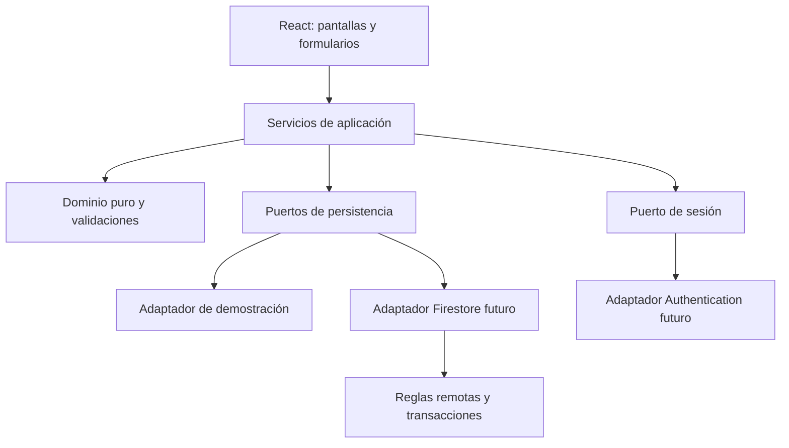

# Arquitectura Firebase propuesta — Fase 04A

**Estado: propuesta para revisión; no aprobada para implementar persistencia.** Consulta técnica: 21 de noviembre de 2026. No se han creado proyectos, credenciales, reglas desplegadas ni conexiones Firebase. El prototipo continúa exclusivamente en memoria.

## Punto de partida y garantías

Se revisaron requisitos, reglas, casos de uso, fases 03B/03C, diseño, Git, `src/domain/`, `src/state/` y `src/data/seed.ts`. No se modifica ninguno de sus contratos aprobados.

Actualmente `reduceDomain` aplica un comando a una copia completa. Solo publica el resultado válido; `DemoContext` actualiza una referencia síncrona antes de publicar en React. `confirmPurchase` conserva la identidad del borrador, valida pendientes y total, resuelve productos nuevos, actualiza inventario, genera movimientos y añade la compra. Los gastos proceden de `spending`, no de movimientos ni de una segunda tabla financiera. Esa coherencia local **no demuestra seguridad remota**.

Se conservarán:

- Un único desembolso canónico por compra, incluidas líneas sin inventario.
- Entrada por cada línea física; las líneas repetidas legítimas conservan sus identidades.
- Cantidades exactas o estados sencillos, sin inferir equivalencias de paquetes.
- Compras históricas con nombres, categorías, cantidades y precios del momento.
- Consumos, ajustes y marcas de lista sin nuevos gastos.
- Imágenes y OCR íntegro fuera de toda persistencia.

Los supuestos numéricos del prototipo siguen pendientes: enteros COP, escala física 1.000 y redondeo positivo al peso por línea. Véase [DECISIONS](DECISIONS.md); esta arquitectura no los ratifica.

## Evaluación y recomendación

| Alternativa | Beneficio | Límite decisivo | Recomendación |
| --- | --- | --- | --- |
| A. Compra + documentos de productos + movimientos separados | Lecturas pequeñas, consultas naturales por producto | La compra debe exigir todos sus efectos. Para 50 productos distintos, una regla raíz que verifica cada saldo supera el presupuesto de accesos. Validar solo los documentos enviados permite omitir efectos. | No aprobar la variante ingenua. Referencia comparativa. |
| B. Inventario/catálogo agregado + diario inmutable | Dos escrituras; pocas dependencias de reglas; consulta mensual acotada | Documento limitado, contención global y validación del contenido completo todavía sin demostrar para 50/100 líneas | **Candidato Spark para una prueba de viabilidad**, detallado en estos documentos. |
| C. Ejecutor confiable y modelo A | Verificación de negocio fuera del cliente; mayor libertad de tamaño | Backend/Functions, facturación, operación y autorización nuevas | Alternativa pendiente si B no supera las pruebas; fuera del alcance autorizado. |
| D. Todo el historial y stock en un documento | Invariante en un solo documento | Crecimiento sin límite frente a documento finito; cada consulta descarga historia | Descartar como arquitectura duradera. |

No hay demostración de imposibilidad universal de Spark. Sí hay un contraejemplo y un límite concretos del diseño A, y una obligación de prueba aún abierta en B. **No debe iniciarse persistencia de compras de producción hasta superar esa obligación o aprobar otra arquitectura.** Una decisión de arquitectura pendiente es un resultado explícito de la fase, no una garantía reducida.

## Capas y responsabilidades futuras



Los componentes no importarán Firestore. El Context mantendrá estado de interfaz y vistas cargadas, no será el mecanismo de exclusión entre dispositivos. Los repositorios expondrán operaciones completas, no `savePurchase` y `saveStock` independientes que permitan fragmentar una confirmación.

Distribución propuesta, **sin crear estos módulos todavía**:

| Módulo | Responsabilidad |
| --- | --- |
| `domain/` existente | Entidades, conversiones, invariantes, cálculos y transformación pura. Reutilizar pruebas actuales. |
| `application/` | Confirmar, ajustar, reconciliar resultados y coordinar sesión; sin SDK. |
| `ports/` | Contratos de compra/inventario, consultas y sesión. |
| `infrastructure/firebase/` | Transacciones, consultas, serialización, conversores y traducción de errores. |
| `state/` | Selección, filtros, formularios, carga, errores y resultados remotos confirmados. |
| `data/` | Ejemplos exclusivos del adaptador de demostración; nunca inicializar la base real con `seed.ts`. |

Interfaces ilustrativas, no implementación ni política aprobada:

```ts
type OperationId = string;
type SaveResult =
  | { status: 'confirmed'; operationId: OperationId; revision: number }
  | { status: 'unknown'; operationId: OperationId }
  | { status: 'rejected'; reason: 'validation' | 'permission' | 'conflict' | 'limit' };

interface HouseholdRepository {
  loadCurrent(): Promise<InventorySnapshot>;
  confirmPurchase(intent: PurchaseIntent): Promise<SaveResult>;
  adjustStock(intent: StockAdjustmentIntent): Promise<SaveResult>;
  lookupOperation(id: OperationId): Promise<OperationLookup>;
  purchasesInPeriod(period: DateRange, cursor?: string): Promise<PurchasePage>;
  pricesForProduct(productId: string, cursor?: string): Promise<PurchasePage>;
}
```

`InventorySnapshot`, `PurchaseIntent`, `StockAdjustmentIntent`, `OperationLookup` y páginas serán tipos de dominio/aplicación: no `DocumentSnapshot` ni `Timestamp` del SDK. Los nombres aquí son contratos propuestos, no exportaciones existentes.

La transacción reejecutará un cálculo **puro** sobre el estado leído. No ejecutará el reducer sobre un historial completo descargado: se extraerá, preservando sus pruebas, la transición de confirmación a una función que reciba inventario actual + intención, y devuelva operación + nuevo inventario. La existencia del ID remoto sustituirá la búsqueda local de compra repetida. Los informes recibirán las compras del periodo; no necesitan todo el historial para sumar un mes. Errores y conversiones remotas no deben entrar en `domain/`.

## Servicios previstos y alcance

- Authentication: una identidad permitida, sin administración ni alta pública en la interfaz; estrategia pendiente DP-01.
- Firestore: estado agregado, diario y perfil mínimo según [modelo](FIRESTORE_MODEL.md); escrituras cerradas hasta demostrar [seguridad](SECURITY.md).
- Hosting estático: futuro alojamiento HTTPS y fallback SPA, sin despliegue en esta fase.
- PWA: futuro manifiesto y caché de recursos estáticos. No confundir instalación con compra offline. No hay service worker implementado hoy.
- OCR posterior: worker local cancelable; motor/idioma cacheables como recursos públicos, nunca recibos ni respuestas privadas.
- Sin Functions, Storage, Analytics, backend propio ni otra base en el candidato inicial. No afirmar que un backend confiable es reemplazable por validaciones React.

## Criterios antes de implementar

1. Aprobar DP-01/02/03/04/05/06/07/13 y revisar las demás recomendaciones.
2. Compilar y atacar reglas completas, no solo autorización, con compras de 5/50/100 artículos, nuevos y repetidos.
3. Demostrar límites de tamaño, expresiones, accesos, reintentos y concurrencia; documentar resultados medidos.
4. Resolver recuperación del ID tras cierre en resultado incierto. Memoria exclusivamente no cubre esa garantía entre sesiones.
5. Validar con la usuaria el acceso y los mensajes; conservar su diseño aprobado.
6. Solo entonces decidir adaptador, región y configuración. Región/costos/latencia deben elegirse antes de crear la base; no se presupone una ubicación ya acordada.

Pruebas y protocolo en [TRANSACTIONS](TRANSACTIONS.md). Cuotas y supuestos en [COST_ESTIMATION](COST_ESTIMATION.md). La [guía oficial de transacciones](https://firebase.google.com/docs/firestore/manage-data/transactions) respalda la distinción entre operación atómica y validación; las decisiones de modelo anteriores son análisis del proyecto.

## Ciclo de vida privado de fotografías — diseño para una fase posterior

```text
selección/cámara → memoria del borrador → worker OCR → revisión
                                             ↓
                   confirmación remota fiable → liberar recursos
cancelación / sustitución de foto / abandono → liberar recursos
```

Un controlador de recursos del borrador será dueño de `File/Blob`, object URLs, imágenes decodificadas, canvas, streams y worker. Guardará un identificador de generación: al cancelar o sustituir la captura se invalida; un resultado tardío no podrá sobreescribir correcciones ni revivir un borrador descartado. Procesar varias fotografías secuencialmente cuando sea posible, no mantener todas sus copias decodificadas. Medir memoria/resolución en el celular antes de fijar límites DP-07.

| Situación | Recursos y comportamiento esperado |
| --- | --- |
| Seleccionar/tomar foto | Mantener solo referencias necesarias en memoria; no base64 en estado persistido; cámara con permiso explícito cuando se implemente |
| OCR en curso | Trabajo cancelable en worker; texto íntegro transitorio; solo propuestas estructuradas llegan al editor |
| Error parcial/total | Conservar correcciones; permitir manual; detener trabajo descartado; retirar referencias de resultados que no se usarán |
| Foto sustituida o retirada | Revocar URL antigua, cerrar bitmap si corresponde, soltar buffers; nunca quitar la foto nueva por una limpieza tardía |
| Compra confirmada remotamente | Limpiar imágenes, miniaturas, OCR íntegro, canvas y referencias, además del borrador; conservar únicamente compra estructurada |
| Error definitivo al guardar | Mantener revisión en memoria mientras se corrige; no prometer recuperación al cerrar |
| Resultado incierto | Conservar identidad estructurada para conciliación; las fotos pueden descartarse al salir. No interpretar la limpieza como cancelación del commit |
| Cancelación/abandono | Limpieza idempotente de todos los recursos; detener stream de cámara y worker; sin datos financieros nuevos por cancelar |
| Desmontaje, cierre o pestaña suspendida | Intentar limpieza como respaldo; no depender de un callback de cierre para cumplir la prohibición de persistir imágenes |

Liberar cada object URL con [`URL.revokeObjectURL`](https://developer.mozilla.org/en-US/docs/Web/API/URL/revokeObjectURL_static), detener los tracks mediante [`MediaStreamTrack.stop`](https://developer.mozilla.org/en-US/docs/Web/API/MediaStreamTrack/stop), y finalizar el worker con [`terminate`](https://developer.mozilla.org/en-US/docs/Web/API/Worker/terminate) cuando ya no se necesite. Retirar referencias es necesario además de revocar la URL. El proceso debe ser seguro si ocurre dos veces.

Prohibido enviar imágenes a Firestore, Storage, servidor OCR, analytics o reportes de fallos. No incluir blobs, miniaturas, object URLs, base64 o OCR completo en localStorage, IndexedDB, Cache API, service worker, historial de navegación ni logs. El futuro worker de PWA solo podrá cachear recursos públicos de aplicación/OCR, nunca capturas ni respuestas privadas. Cachear el motor no equivale a cachear los recibos.

**Garantías y límites:** la aplicación puede evitar persistencia y subida deliberadas, revocar accesos propios y liberar referencias. No puede garantizar borrado físico inmediato de RAM, swap, volcados del sistema o capturas del dispositivo; el recolector de basura es del navegador. Tampoco borra el archivo original elegido desde la galería ni una foto que la cámara del sistema haya guardado fuera de la web. Un cierre forzado puede impedir cualquier limpieza ejecutable. No afirmar eliminación de esas copias ajenas.

En una prueba posterior: inspeccionar red y almacenamientos tras éxito/error/cancelación; comprobar revocación y tracks detenidos, worker sin mensajes tardíos, navegación repetida y memoria en fotos múltiples. No hay escáner implementado ni prueba de privacidad de imágenes reales en 04A.
