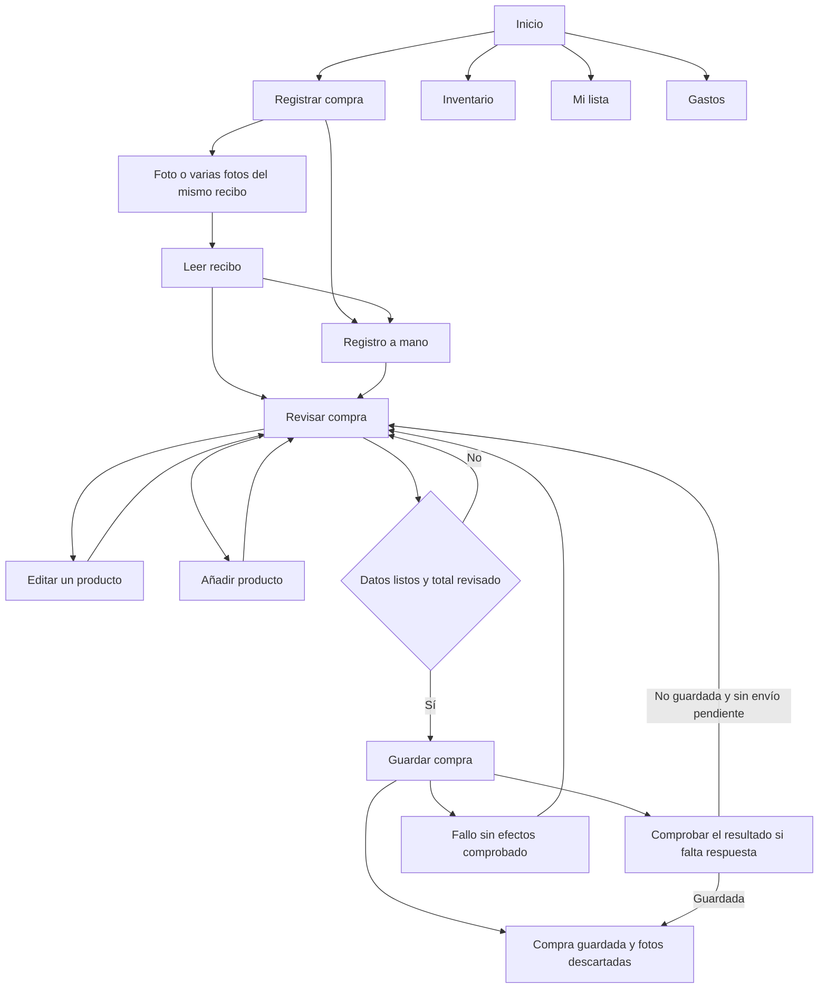

# Mi Casa — Recorridos de experiencia

Estado: ajustes de Fase 02 sobre la identidad visual aprobada provisionalmente. Describe el comportamiento que necesitará el prototipo posterior, no funcionalidades reales de compra.

Fuentes: [casos de uso](../CASOS_USO.md), [requisitos](../REQUISITOS.md), [reglas](../REGLAS_NEGOCIO.md) y [decisiones DP](../VISION.md#8-decisiones-pendientes-de-aprobación). La apariencia compartida se define en [DESIGN_SYSTEM.md](DESIGN_SYSTEM.md).

## 1. Mapa de navegación

Fuera del registro, la barra principal nombra Inicio, Inventario, Mi lista y Gastos. «Registrar compra» sigue siendo la acción dominante de Inicio. Durante elección, captura y revisión se sustituye por navegación contextual, sin cambiar las cuatro secciones principales del producto.

Con letra grande y poco ancho, la navegación principal pasa al flujo de la página antes del contenido, con todos los destinos visibles. El orden de teclado y de lectura coincide con esa posición. No se reduce la letra ni se obliga a pasar por un menú oculto. En anchos suficientes puede permanecer fija abajo.

No se presupone que navegar fuera de un borrador lo guarde. Antes de enviar, una salida con cambios debe ofrecer seguir revisando o descartar con una explicación clara. Durante envío, salir no equivale a anular la operación.

## 2. Pantallas y muestras disponibles

| Pantalla | Ejemplo local | Qué permite evaluar |
| --- | --- | --- |
| A · Inicio | [index.html](../../design/preview/index.html) | Marca, saludo, gasto del mes, acción principal, accesos e historial breve. |
| B · Inventario | [inventario.html](../../design/preview/inventario.html) | Búsqueda, categoría, productos con cantidad o estado y acción Actualizar. |
| C · Registrar compra | [registrar-compra.html](../../design/preview/registrar-compra.html) | Dos vías de registro, indicaciones para varias fotos y alternativa de imagen existente. |
| D · Revisar compra | [revisar-compra.html](../../design/preview/revisar-compra.html) | Datos del recibo, procedencia, un producto dudoso, adición manual y total. |
| E · Mi lista | [mi-lista.html](../../design/preview/mi-lista.html) | Lista activa temporal, pendientes, comprados y descarte. |
| F · Gastos | [gastos.html](../../design/preview/gastos.html) | Total, categorías, compras y filtros sencillos por periodo, establecimiento y categoría. |
| Estados y edición | [estados.html](../../design/preview/estados.html) | Errores, espera, resultado incierto, edición de línea, actualización y confirmación de descarte. |
| Galería | [galeria.html](../../design/preview/galeria.html) | Comparación de Inicio, Inventario y Revisión en una propuesta común. |
| Captura auxiliar | [capturar-recibo.html](../../design/preview/capturar-recibo.html) | Navegación contextual, espacio de foto y revisión, sin cámara ni OCR. |
| Compra grande · Todos | [revisar-compra-grande.html](../../design/preview/revisar-compra-grande.html) | 50 líneas, contadores, desplegables y saltos al total. |
| Compra grande · Pendientes | [revisar-pendientes.html](../../design/preview/revisar-pendientes.html) | Solo los 6 pendientes; conserva total y pertenencia de los 50. |
| Compra breve · Pendientes | [revisar-compra-pendientes.html](../../design/preview/revisar-compra-pendientes.html) | El mismo patrón de filtro con el ejemplo de cinco productos. |

Los enlaces entre ejemplos y entre Todos/Por revisar solo cambian de muestra estática. Los desplegables nativos permiten explorar opciones y formularios con teclado. Los botones de negocio no guardan, editan ni procesan información; no hay datos de compra que se conserven. El comprobador de tamaños es una herramienta de QA separada y es la única página con JavaScript.

## 3. Registrar una compra por fotografía

Referencia: CU-01 y CU-08; RF-COM-01, RF-COM-02, RF-OCR-01 a RF-OCR-07; RB-CO-01 a RB-CO-07.

1. **Inicio:** elegir «Registrar compra».
2. **Elegir vía:** «Tomar foto del recibo». La alternativa manual tiene nombre y explicación propios.
3. **Captura futura:** revisar cada imagen y añadir otra parte del mismo recibo si hace falta. «Leer recibo» inicia el proceso cuando las fotos estén listas. No fijar un máximo de fotos sin DP-07.
4. **Espera:** «Estamos leyendo tu recibo». Mantener visible «Continuar a mano». No mostrar porcentajes si no se conoce progreso real.
5. **Revisión:** mostrar fecha y establecimiento, las líneas obtenidas y cualquier duda. La fotografía no supone datos correctos.
6. **Corrección:** editar solo la línea elegida; añadir productos manualmente cuando falten; revisar coincidencias con existentes.
7. **Resumen:** comprobar total y posibles diferencias. Una presentación no resuelta impide un efecto exacto de inventario; no dejar guardar mientras exista ese impedimento.
8. **Guardar:** «Guardar compra» confirma el conjunto una sola vez. Esperar comprobación remota antes del mensaje final y del descarte por éxito.

**Alternativas y recuperación:**

- Cámara denegada: «No pudimos abrir la cámara. Puedes elegir una foto o registrar la compra a mano». No pedir permisos repetidamente ni bloquear la compra manual.
- Foto borrosa o formato desconocido: identificar la imagen afectada, sustituirla o seguir a mano conservando datos revisados.
- Varias fotos con superposición: proponer revisión de posibles repeticiones; nunca borrar líneas legítimas por coincidencia de texto.
- OCR parcial: mostrar qué falta y permitir completarlo sin reiniciar.
- OCR total fallido: abrir el mismo borrador en modo manual. No exigir una nueva fotografía para continuar.
- Cancelar antes de enviar: descartar borrador y recursos; no introducir compras, stock ni gasto.

La pantalla auxiliar de captura representa foto principal, Añadir otra foto, Revisar compra y alternativa manual, aclarando que no se toma ninguna imagen. Su navegación contextual muestra Volver y el paso actual. En el producto futuro deberá informarse cuándo se inicia la lectura real; aquí el enlace a revisión solo abre el ejemplo, sin ejecutar OCR.

## 4. Registrar manualmente y añadir después del reconocimiento

Referencias: CU-02 y CU-04; RF-COM-03, RF-COM-06, RF-COM-07, RF-INV-08.

**Compra sin recibo:** Inicio → Registrar compra → Registrar compra manualmente → fecha y establecimiento → Añadir producto → resumen → Guardar compra.

**Después del reconocimiento:** Revisar compra → Añadir producto → elegir existente o nuevo → cantidad y precio/importe → Listo, volver a la compra → mismo resumen.

El formulario de línea se reutiliza en ambos recorridos. Buscar existentes es visible antes de crear uno nuevo; las coincidencias no se aceptan automáticamente. Los detalles de un producto nuevo incluyen categoría y tipo de control cuando sean necesarios, sin expandir de entrada todos los campos de toda la compra.

La acción de completar una línea vuelve al resumen; no guarda aún la compra ni crea por sí sola un gasto. Una adición manual lleva «Añadido a mano», sin tono de advertencia por proceder de la usuaria.

Si cancela la línea nueva, vuelve al borrador anterior. Si faltan datos necesarios, se indican en su campo y se conservan las otras entradas. Precio desconocido se muestra como pendiente, nunca como cero. Un producto gratuito verificado puede tener importe cero.

Los campos definitivos de creación y conversión dependen de DP-02, DP-03 y DP-08. No se ha aprobado un catálogo, un valor inicial de existencias ni una conversión por defecto.

La [muestra específica de artículo no detectado](../../design/preview/estados.html#anadir-producto) incluye búsqueda de existentes, resultado de ejemplo con Usar este producto y «¿No está? Crear un producto nuevo». Este último despliega los campos propios de creación, sin obligar a verlos al elegir un producto existente. Cantidad, unidad y precio tienen etiquetas independientes. El ejemplo usa 0,5 kg a $9.800 por kg, importe $4.900. «Guardar artículo en la compra» completa conceptualmente la línea, sin confirmar el conjunto; en esta vista previa no realiza guardado alguno.

## 5. Revisar y corregir una compra

Referencias: CU-03; RF-COM-04, RF-COM-05, RF-COM-08, RF-COM-12; RB-IM-01 a RB-IM-04.

La pantalla muestra líneas resumidas: procedencia o duda, nombre, cantidad/presentación e importe de línea. «Ver y editar» despliega el precio conocido o la explicación del dato pendiente y conserva acceso a Editar producto y Quitar. Un producto reconocido también puede editarse. Se usa `details/summary` nativo en la muestra para evaluar esta presentación con teclado, sin un formulario abierto por cada artículo.

«Editar» o «Revisar» abre un formulario corto, propuesto como pantalla completa en móvil. Encabezado con el producto, etiquetas claras y salida «Listo, volver a la compra». Al regresar, restaurar foco al control que abrió la edición y conservar la posición en el listado. No sacar a la usuaria del registro completo.

La procedencia y la validación son dimensiones distintas. «Leído del recibo» no equivale a «correcto». Si una línea reconocida necesita revisión, prima la etiqueta «Por revisar» con el problema concreto. La procedencia original debe conservarse conceptualmente; editar a mano una cantidad detectada no convierte toda la línea en una adición nueva.

«Quitar» retira esa línea del borrador y recalcula el resumen; no borra el producto ni una compra pasada. Propuesta de diseño para evitar una acción accidental: confirmación breve contextual en la misma línea, con «Quitar de esta compra» y «Conservar producto». No añadir una acción de eliminación histórica, pendiente en DP-05.

**Si el total difiere:** mostrar ambos importes y diferencia; revisar líneas, descuentos y cargos explícitos. No inventar ajustes ni limitarse a un aviso rojo. El ejemplo del catálogo usa suma $61.100, recibo $63.100 y diferencia $2.000. Las tolerancias y reparto de descuentos siguen pendientes en DP-02/DP-04.

**Muestra principal:** Mercado La Esquina, 21 de noviembre de 2026, dos fotos del mismo recibo y cinco líneas. Arroz $7.800 + leche $12.600 + huevos $18.900 + detergente $14.800 + banano añadido a mano $7.000 = **$61.100**. La leche requiere confirmar presentación; el botón Guardar aparece deshabilitado aunque el total coincida. Los precios son datos ficticios, no estimaciones de OCR real.

### Revisión de 40, 50 o más productos

Antes del listado se muestran establecimiento, fecha editable, total completo, productos totales, reconocidos del recibo y pendientes. Se distingue expresamente que los pendientes ya están incluidos en el total de productos. Añadir producto permanece disponible, incluso cuando el reconocimiento no requiere ninguna corrección; no depende del estado de error del OCR.

«Todos» mantiene el listado entero, con edición en todas las líneas. «Por revisar» reduce solo la vista a las líneas que necesitan atención. No cambia cantidades, total ni pertenencia de las demás líneas. En el prototipo futuro, al resolver el último pendiente debe indicarse que ya no hay pendientes y ofrecer Ver todos y el resumen, sin guardar automáticamente. No se agrega una acción masiva de aprobar por confianza.

La muestra grande contiene 50 productos: 47 leídos del recibo, 3 añadidos a mano y 6 pendientes, por **$435.600**. Sus vistas Todos/Por revisar se materializan en archivos HTML distintos; no hay un filtro de datos reales ni operaciones sobre la compra. El ejemplo breve también tiene su vista de un pendiente.

La cabecera ofrece «Ir al total y guardar» como salto a la confirmación al final, disponible también después de cada diez artículos del ejemplo largo. El salto no pulsa Guardar ni salta las validaciones: si quedan datos necesarios pendientes, el botón continúa bloqueado y se puede volver a Por revisar. Se repite Añadir producto en el resumen final. No se fija una barra de resumen alta encima de contenido ampliado.

En el prototipo posterior, al entrar al editor y regresar se mantendrán filtro y posición, con foco en la línea editada o en el siguiente pendiente cuando corresponda. Los cambios de contador deben anunciarse con moderación; no mover el foco por cada carácter. Esa conservación no está implementada como recuperación de borradores en esta fase.

## 6. Guardado, falta de conexión y salida

Referencia: CU-10; RF-COM-09, RF-COM-11, RF-COM-13, RF-AUT-04; RB-CO-06, RB-CO-07 y RB-FT-03.

| Momento o resultado | Mensaje y acciones previstos | Qué debe evitarse |
| --- | --- | --- |
| No hay conexión antes de enviar | «No hay conexión. No hemos enviado esta compra». Ofrecer reintento cuando vuelva el servicio; advertencia de salida según la política aprobada. | Afirmar que está guardada o que el borrador sobrevivirá un cierre sin resolver DP-06. |
| Guardando | «Estamos guardando tu compra». Deshabilitar reenvío; mantener contexto. | Doble toque que cree otra operación o promesa de cancelación del envío. |
| Éxito comprobado | «Compra guardada». Mostrar acceso a Inicio y al detalle; fotos y texto OCR íntegro descartados. | Anunciar éxito solo por caché o escritura local pendiente. |
| Fallo sin efectos comprobado | «La compra no se guardó. Tus productos y tus gastos no han cambiado». Permitir corregir o volver a intentar. | Usar este mensaje si no se sabe el resultado. |
| Resultado incierto | «Estamos comprobando tu compra. No la registres otra vez mientras lo comprobamos». Recuperar acceso/conexión y conciliar la misma identidad. | Crear otra compra para «reintentar». |
| Sesión vencida | Explicar que necesita volver a entrar; recuperar acceso y comprobar el intento anterior. | Perder la referencia y reenviar a ciegas. |

Antes de enviar, salir de un borrador con contenido puede mostrar «¿Descartar esta compra? Todavía no está guardada», con «Seguir revisando» y «Descartar compra». Una salida sin datos no requiere esta interrupción.

Las muestras de registro y revisión ya usan navegación contextual: Volver y nombre del paso. Se retiran barra principal y enlace de marca a Inicio de estas pantallas para no sugerir una salida directa del registro. Volver desde captura/revisión abre en la muestra el [estado de confirmación](../../design/preview/estados.html#salir-compra); no intercepta realmente atrás del navegador ni conserva estado. La confirmación ofrece «Seguir revisando» o «Descartar compra y salir» y explica la pérdida de artículos revisados y fotos. En el producto futuro se mostrará solo cuando existan cambios sin guardar y según el estado de envío.

Durante el envío, el mensaje cambia: «Aún estamos comprobando si se guardó. Salir no cancela una compra que ya pudo guardarse». La limpieza local de imágenes al salir no revierte un compromiso remoto.

DP-06 debe resolver recuperación del identificador después de recargar o cerrar. No se diseña un mensaje de «todo conservado» sin esa decisión. La vista previa muestra estados independientes, sin simular que suceden al pulsar Guardar.

## 7. Consultar y actualizar inventario

Referencia: CU-05; RF-INV-02 a RF-INV-10; RB-CA-01 a RB-CA-04 y RB-IN-01 a RB-IN-04.

Inventario → buscar nombre o elegir categoría → leer cuánto queda → Actualizar → revisar nuevo dato → Guardar cantidad/estado.

Para control exacto se muestra cantidad y unidad, con la palabra «Cantidad» como contexto. El formulario pregunta «¿Cuánto hay ahora?», evitando confundir saldo absoluto con añadir otra entrada. Para control sencillo se muestra la palabra «Estado» y una de tres opciones: Hay suficiente, Queda poco o Se agotó. No exigir número.

Actualizar por uso o corrección no registra gasto ni modifica una compra anterior. Si quiere registrar una compra nueva debe ir al flujo de compra. El ejemplo auxiliar aclara: «Esto cambia cuánto queda, sin registrar un gasto».

Si no encuentra un producto, «Añadir producto» permite un alta independiente. Saldo inicial y cambios entre tipos o unidades requieren DP-03; no se elige automáticamente una cantidad a partir de «Queda poco». Si otro dispositivo cambió el dato mientras editaba, pedir revisión del valor actualizado.

Estado vacío: mostrar una invitación breve a añadir o registrar, sin inventar artículos ni recomendaciones.

## 8. Consultar gastos y precios anteriores

Referencia: CU-06; RF-GAS-01 a RF-GAS-08; RB-GA-01 a RB-GA-04.

Gastos → elegir periodo → leer total → revisar categorías → opcionalmente elegir establecimiento/categoría → abrir compra y consultar detalle estructurado.

Los filtros tienen etiqueta visible y opción «Todos/Todas» para restablecerlos. En la futura interfaz, cambio de filtro y total actualizado deben mantener contexto y anunciarse sin saltos de foco. Un filtro por categoría utiliza el importe atribuido a ella, no el total completo de cada compra mixta.

El detalle de compra futuro muestra fecha, comercio, productos/conceptos, cantidades e importes. Puede dar acceso al contexto de precios anteriores de un producto, manteniendo presentación y unidades. No ofrece la foto ni un reprocesamiento. La forma de comparar precio unitario y efectivo sigue pendiente en DP-12; no se añaden predicciones ni gráficos nuevos por este diseño.

Datos de Inicio y Gastos: noviembre de 2026, cuatro compras por $54.100, $85.600, $63.200 y $83.500; suman **$286.400**. Categorías: alimentos $182.400, limpieza $64.000 y cuidado personal $40.000; también suman $286.400. No hay gastos duplicados entre compra y categoría. La compra de la pantalla Revisión es un borrador distinto, no incluido en estos totales.

Sin resultados para un filtro es distinto de error al cargar. El primero permite mostrar cero para el conjunto vacío conocido; el segundo necesita un aviso de carga fallida. No ocultar gastos de establecimiento desconocido del total general si se aprueba esa política, DP-09.

## 9. Lista temporal

Referencia: CU-07; RF-LIS-01 a RF-LIS-04; RB-LI-01 y RB-LI-02.

Mi lista → crear si no hay una → añadir artículos → marcar/desmarcar lo comprado → finalizar → confirmar descarte.

El nombre «Mi próxima compra» de la muestra identifica una lista temporal; no propone una planificación semanal obligatoria ni reposición automática. Pendientes y comprados se agrupan con etiquetas textuales y controles de marca reconocibles.

Marcar un producto no registra la compra, el gasto ni la entrada de inventario. Se puede corregir una marca sin consecuencias externas. No se ofrece conversión automática de lista a compra.

Finalizar explica cuántos artículos se descartarán, incluidos los pendientes. La confirmación de ejemplo muestra «Finalizar y descartar» y «Seguir con mi lista». La lista deja de estar activa y no se crea historial de listas.

Su conservación después de un cierre sigue pendiente en DP-06. No prometer acceso desde otro dispositivo ni listas permanentes.

## 10. Gastos sin inventario

Referencia: CU-09 y RF-GAS-04; DP-13 pendiente.

Dentro del recorrido manual o de revisión, la línea puede representar un concepto sin inventario si corresponde realmente a un servicio u otro desembolso no físico. El futuro formulario debe permitir esa distinción sin exigir una unidad doméstica ficticia; el detalle financiero conserva concepto, importe y categoría.

La entrada exacta a un gasto independiente sigue pendiente de DP-13; no se crea una quinta sección principal. Los productos físicos siempre se vinculan al inventario. Este recorrido está documentado, no implementado como una nueva pantalla funcional en la vista previa.

## 11. Criterios de aceptación del diseño y siguiente validación

| Revisión | Evidencia en la propuesta | Pendiente de prueba |
| --- | --- | --- |
| Encuentra Registrar compra | Acción dominante en Inicio y página de elección con dos vías. | Reconocimiento sin ayuda con la usuaria. |
| Puede corregir y añadir después de lectura | Desplegables por línea, edición de reconocidos, Añadir producto siempre visible y formulario específico. | Probar teclado real, vuelta, foco y conservación en prototipo interactivo. |
| No confunde cantidad con estado | Etiquetas Cantidad/Estado y ejemplos de ambos. | Comprensión de términos con la usuaria. |
| Comprende total y dudas | Un total, un aviso concreto y guardado bloqueado con explicación. | Prueba de errores y diferencia de importes. |
| Entiende la lista temporal | Grupos claros, explicación y confirmación de descarte. | Comprensión de la independencia respecto al inventario. |
| Usa móvil y texto ampliado | Consultas de contenedor relativas al texto, navegación en flujo cuando falta espacio y campos de altura natural. | Matriz 360/390/430/768 px al 100 % y 200 %; además reflujo a 320 px, zoom y teclado. |
| Comprende una compra grande | Muestras de 50 productos y 6 pendientes, total estable, contadores y saltos al resumen. | Renderizado y comprensión del filtro con la usuaria; no se asume que menos filas implique mejor comprensión. |
| Recuperación sin duplicados | Estados de fallo comprobado e incertidumbre separados. | Estrategia técnica y contrato de DP-06/DP-07, fuera de esta fase. |

La usuaria solicitante comunicó una revisión externa de la propuesta previa y aprobó provisionalmente su identidad y organización. No se han realizado pruebas de esta corrección con la usuaria final ni con lector de pantalla. El intento local de renderizado sigue bloqueado por permisos; la matriz preparada no se ha ejecutado aquí. [comprobar-diseno.html](../../design/preview/comprobar-diseno.html) permite ejecutarla en un navegador disponible, con las limitaciones de QA documentadas en DESIGN_SYSTEM.md. La aprobación visual no resuelve automáticamente las reglas de negocio pendientes ni autoriza Fase 03.
